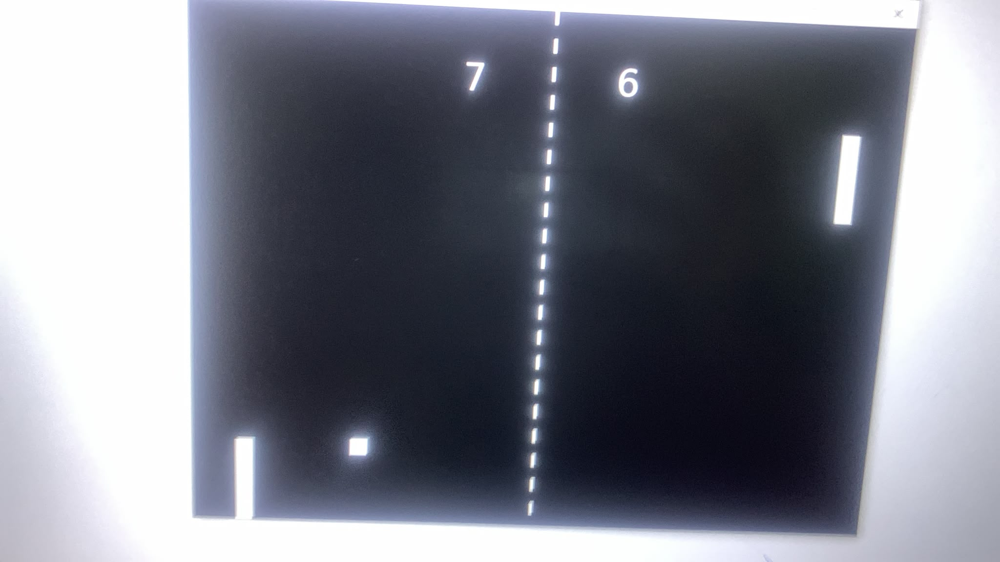

# Pong Love2D

## Student Information
**Full Name:** Dalia Moqadi


## About the Game
This is a simple Pong game made with Lua and LÖVE2D. The game has two paddles and one ball. Two players can move the paddles up and down. The ball moves and bounces from the walls and the paddles. The game also has a score.

## How to Run
Open the project folder in the terminal and write:

```bash
love .
```

## Controls
- Player 1:
  - `W` = Up
  - `S` = Down

- Player 2:
  - `Up Arrow` = Up
  - `Down Arrow` = Down

- `Space` = Start the ball

## My Own Change
My own change is the Space key. The ball stays in the center until the player presses Space. After a point, the ball goes back to the center and waits for Space again.

## Screenshot


## Demo Video
[Game Demo](demo/pong-demo.mp4)